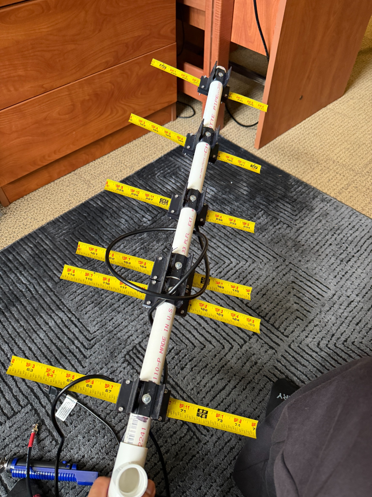
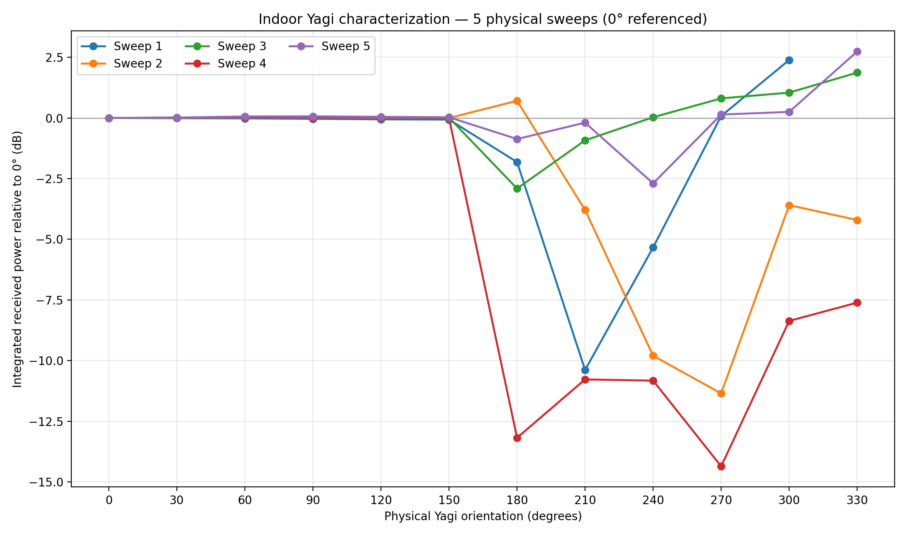
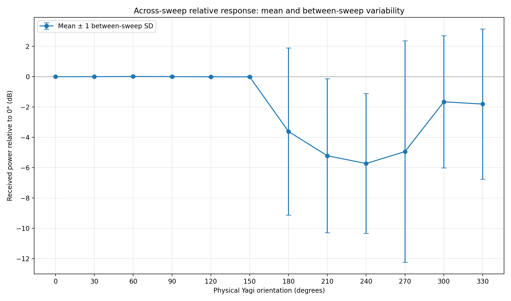

# Six-Element Yagi Antenna — PlutoSDR Characterization

An experimental RF and digital signal processing project using a **constructed six-element tape-measure Yagi**, **ADALM-Pluto SDR**, and an **Arduino UNO R4 WiFi + CC1101 reference transmitter**.



> **Experiment status (November 25, 2026):** RF reception, FFT/Welch PSD analysis, and **five physical indoor angular sweeps** are complete. These are preliminary, **uncalibrated** received-power measurements, **not** a validated free-space radiation pattern or antenna-gain measurement.

## The RF measurement chain

```text
Arduino UNO R4 WiFi → SPI → CC1101 (commanded 434.0 MHz) → TX antenna
                                    over-the-air RF
Six-element Yagi → coax/BNC-to-SMA → ADALM-Pluto SDR → USB → Python/Spyder
                                                 IQ → FFT + Welch PSD
                                                     ↓
                                          433.87–433.97 MHz
                                           band-power estimate
                                                     ↓
                                           directional sweeps
                                                     ↓
                                            statistical analysis
```

### Recorded hardware and processing configuration

| Parameter | Experiment setting |
|---|---|
| Antenna | Six-element Yagi, original **440 MHz** supplied design, ~66 cm boom |
| Reference transmitter | Arduino UNO R4 WiFi with RadioLib CC1101 |
| Programmed transmitter frequency | **434.0 MHz** |
| Observed PlutoSDR carrier | ~**433.921 MHz** (independent oscillator calibration not performed) |
| Receiver LO | **434.2 MHz** |
| PlutoSDR rate / bandwidth | ~**3 MSPS** / **2 MHz** |
| Receiver gain | **20 dB**, manual |
| IQ buffer size | **16,384 complex samples** |
| Welch PSD | **2,048-sample segments**, complex two-sided |
| Power integration | **433.87–433.97 MHz** (uncalibrated sample power) |


## View the complete result gallery

**[Open all five individual sweep graphs, the FFT/PSD MHz screenshots, original polar plots, and CSV files](results/README.md).**

## Five-sweep characterization

**Five physical angular sweeps, 59 total orientation measurements:** Sweep 1 covers 0°–300° (missing 330°); Sweeps 2–5 cover 0°–330° in 30° increments. Two additional 0°–150° half-sweeps and multiple stationary/CC1101 ON/OFF checks are documented separately.





The section **0°–150° is almost flat within each run** (0.015–0.068 dB range), while **180°–330° varies substantially between runs**. At **270°**, the between-sweep sample standard deviation is **7.31 dB**. Deep attenuation occurs at different angles in different runs; this data does **not** establish a consistent radiation-pattern null, measured beamwidth, gain, or validated front-to-back ratio.

The original polar plots use a radial shift that can visually exaggerate small differences. For quantitative interpretation, use the *0°-referenced Cartesian plots* and CSV values.

## Project navigation

| Folder | Contents |
|---|---|
| [`hardware/`](hardware/) | Construction, original design attribution, photographs and setup |
| [`firmware/`](firmware/cc1101_reference_transmitter/) | Arduino CC1101 firmware, pinout and safety cautions |
| [`src/`](src/) | PlutoSDR FFT/PSD/angle-acquisition Python source and archives |
| [`experiments/`](experiments/) | Executed measurement protocol and controls |
| [`results/`](results/) | Five-sweep CSVs and plotted evidence |
| [`analysis/`](analysis/) | Consolidated statistical report and reproducible analysis code |
| [`theory/`](theory/) | Six handwritten RF/DSP theory PDFs |

### Reproduce the statistical analysis

From the repository root:

```bash
python -m pip install -r requirements.txt
python analysis/analyze_yagi.py
```

This reads [committed raw measurements](results/data/yagi_five_sweeps_raw.csv), regenerates summary CSVs in `results/data/` and plots in `results/plots/`. No SDR hardware is required to analyze the recorded data.

To acquire **new physical measurements**, follow [the receiver documentation](src/README.md) and [measurement protocol](experiments/controlled-angular-sweep.md). The receiver script is interactive and requires a PlutoSDR.

## What is and isn't demonstrated

**Demonstrated:** Constructed antenna, detected reference carrier, IQ acquisition, FFT, Welch PSD integration, transmitter ON/OFF comparisons, repeated manual physical sweeps, statistical analysis and engineering documentation.

**Not demonstrated:** calibrated dBm/dBi values, independent CC1101 frequency accuracy, absolute antenna gain, validated free-space radiation pattern, reliable null direction/beamwidth or independently verified S11 at the test frequency. The original 440 MHz design predicts **8.917 dBd** gain and **47.4°** horizontal beamwidth; these are supplied design-software predictions **not measured project results**.

The experiment was indoors with handheld positioning, furniture, a nearby Christmas tree and potentially changing cable geometry; no specific object has been established as the cause of multipath.

## Reproducibility and safety

PlutoSDR IQ values are **uncalibrated sample units**, not RF watts/dBm; the in-band median PSD is not a separate transmitter-off noise measurement. The UNO R4 WiFi operates with **5-V I/O**, while CC1101 logic is **3.3-V**: verify level shifting and power connections. A continuous unmodulated carrier does not by itself provide amateur station identification; transmit only when authorized, supervised, and properly identified. The published sketch defaults to RF transmission disabled.

## Attribution

The original geometry/design sheet was supplied by **Travis (KQ4VQC), President of the UCF Amateur Radio Club**; underlying design authorship should be verified. The project's own contributions are construction, SDR/DSP implementation, radio integration, data collection, and statistical analysis.
