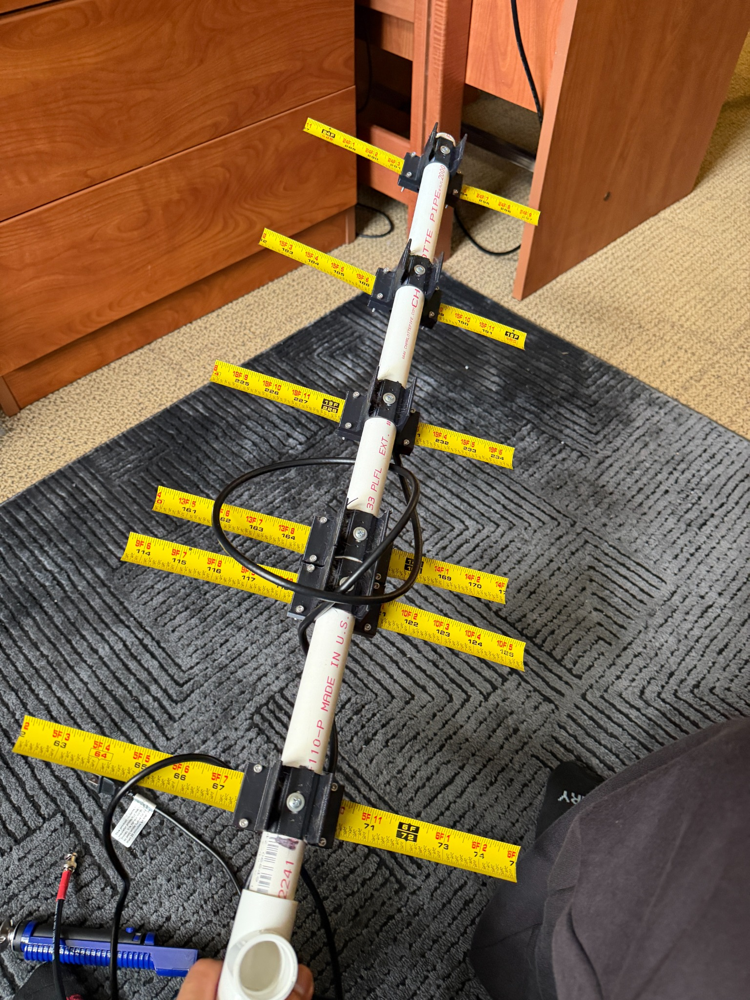
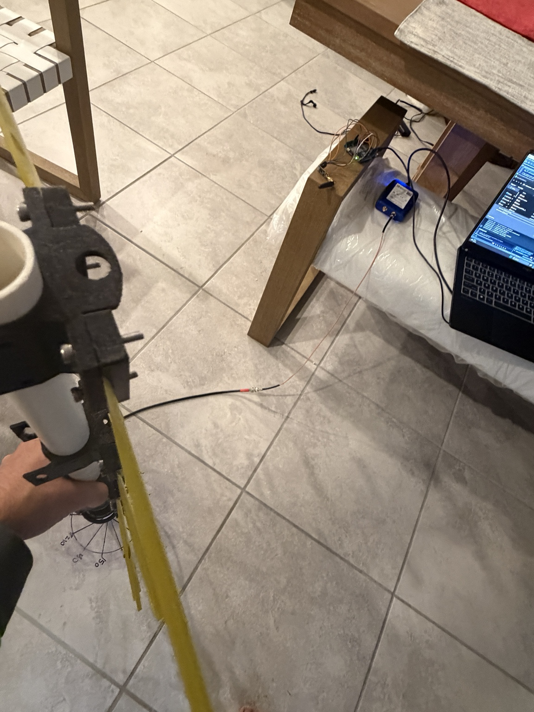
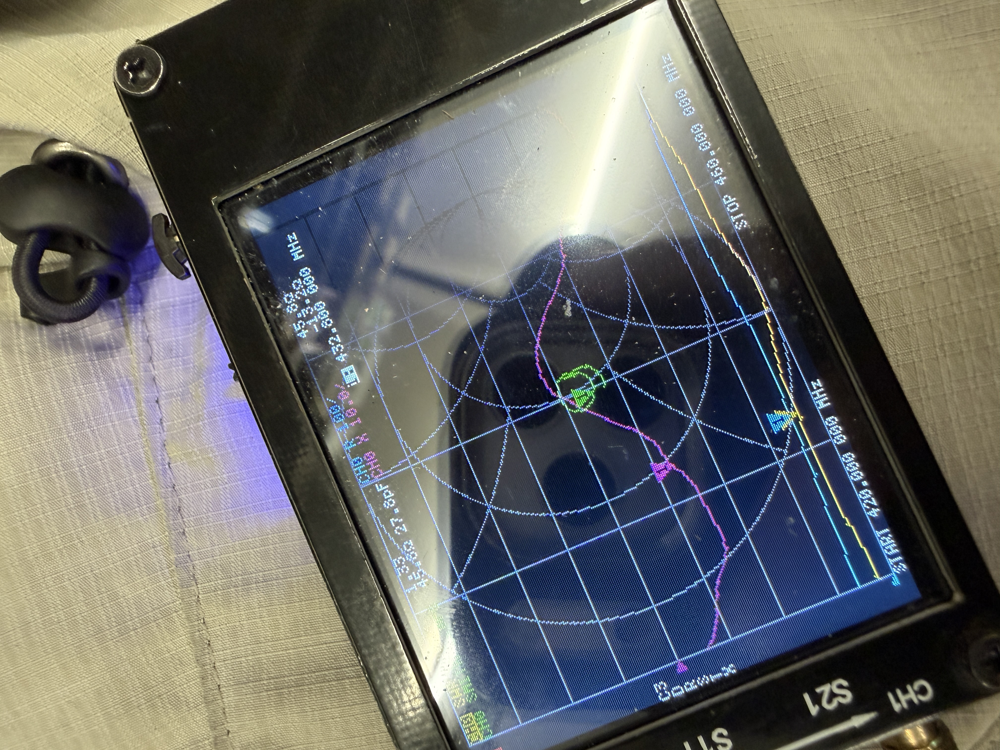
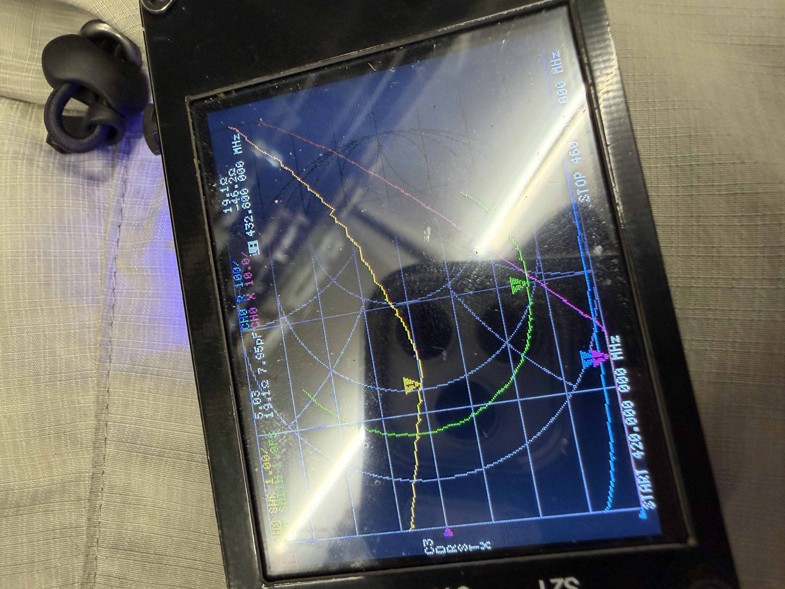

# Hardware, construction and indoor test setup

The project uses a **six-element tape-measure Yagi** on an approximately **66 cm nonmetallic boom**, connected to an **ADALM-Pluto SDR** through coax and a BNC-to-SMA adapter. The separate reference transmitter is an **Arduino UNO R4 WiFi + CC1101**.

See [original 440 MHz antenna geometry and design attribution](antenna-design.md) and the [photographic build record](build-process.md). Predicted gain/beamwidth on the original design sheet are **not experimental results**.

## Original construction imagery

- [Front](images/yagi-front-view.jpg), [reverse](images/yagi-reverse-view.jpg), [upright](images/yagi-assembled-upright.jpg), [floor](images/yagi-assembled-floor.jpg).
- [Driven-element feed](images/driven-element-feed.jpg), [PlutoSDR connection](images/plutosdr-connection.jpg), [supplied design screenshot](images/original-yagi-design.jpg).

## November 25 indoor measurement photography

The [`photos/`](photos/) folder preserves additional Arduino/CC1101 jumper wiring, antenna/transmitter arrangements, and the marked circular floor reference (including `IMG_9502(1).jpeg` and `IMG_9507.jpeg`). The antenna was **hand-positioned**, not mounted on a precision rotary fixture. Furniture, floor reflection, a nearby Christmas tree, coax routing and operator proximity could change measured power; no single cause has been proven.

## VNA matching and impedance measurement photographs

The two network-analyzer screenshots were uploaded separately and are preserved at their original filenames:

*Figure — VNA measurement display, including frequency-dependent traces and Smith-chart visualization. The photographed screen has glare, so the displayed marker values should not be treated as reliably transcribed numerical results.*

*Figure — Additional VNA display photographed during antenna matching checks. This is evidence that network-analyzer inspection was performed, not proof of a particular calibrated S11 minimum or measured antenna gain.*

**Measurement interpretation:** The screen photographs show antenna impedance/matching characterization work, but they do not independently establish a precise S11, return-loss, VSWR, feed impedance or resonance frequency without legible marker readouts, instrument settings/calibration, and preferably exported VNA data (such as Touchstone `.s1p`). The antenna's supplied **440 MHz design frequency** must be distinguished from the CC1101 reference experiment near **433.92 MHz**. No gain or beamwidth measurement is implied by a VNA impedance plot.

**Electrical caution:** Arduino UNO R4 WiFi outputs 5-V logic; CC1101 digital I/O uses 3.3-V levels. Verify correct power supply and safe level translation rather than assuming electrically compatible interfaces because SPI worked.

[Reference-transmitter firmware](../firmware/cc1101_reference_transmitter/README.md)
