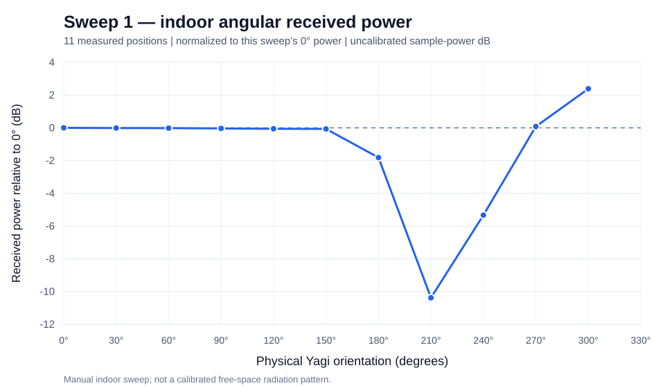
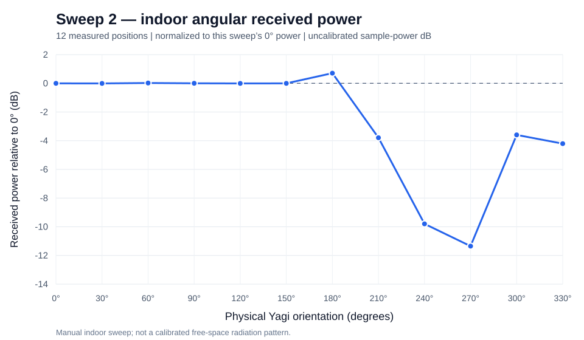
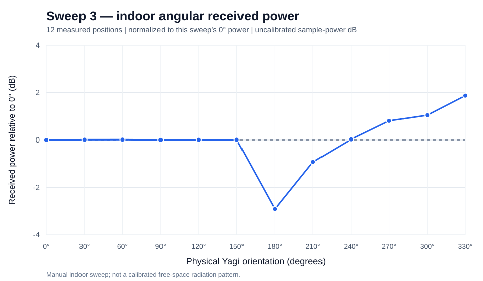
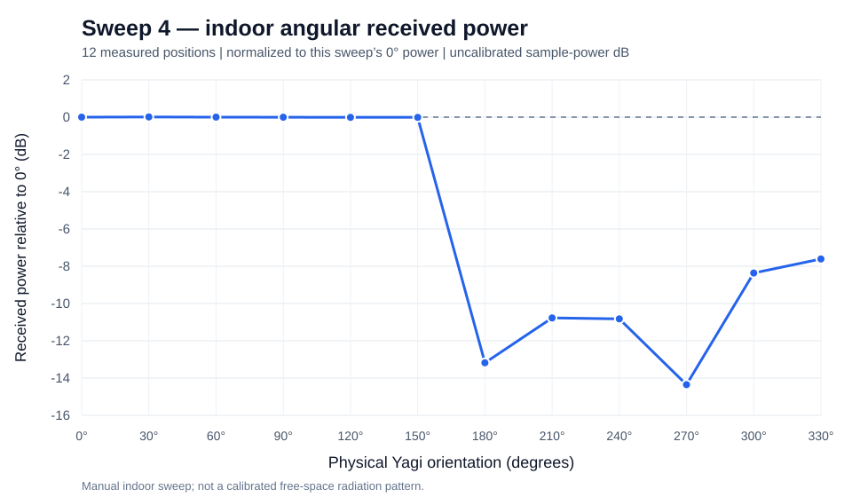
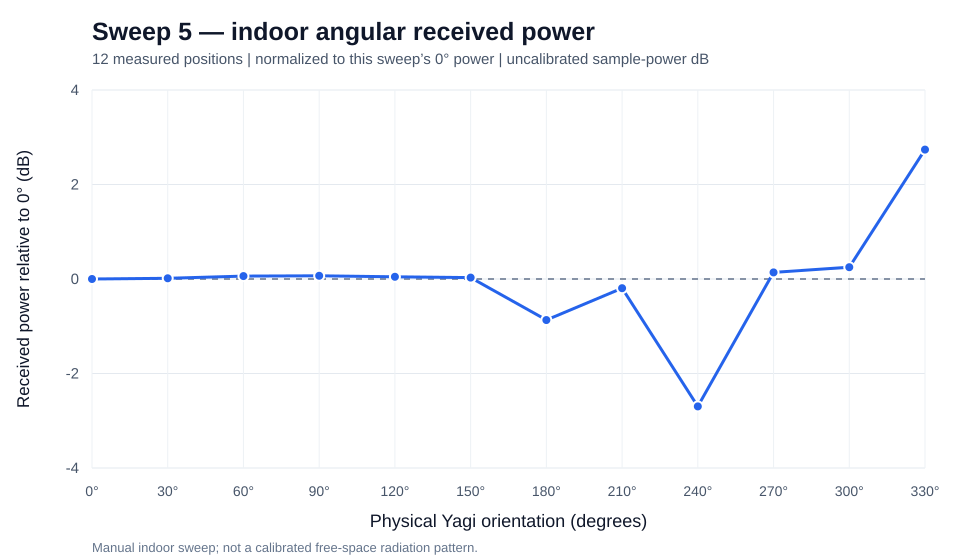
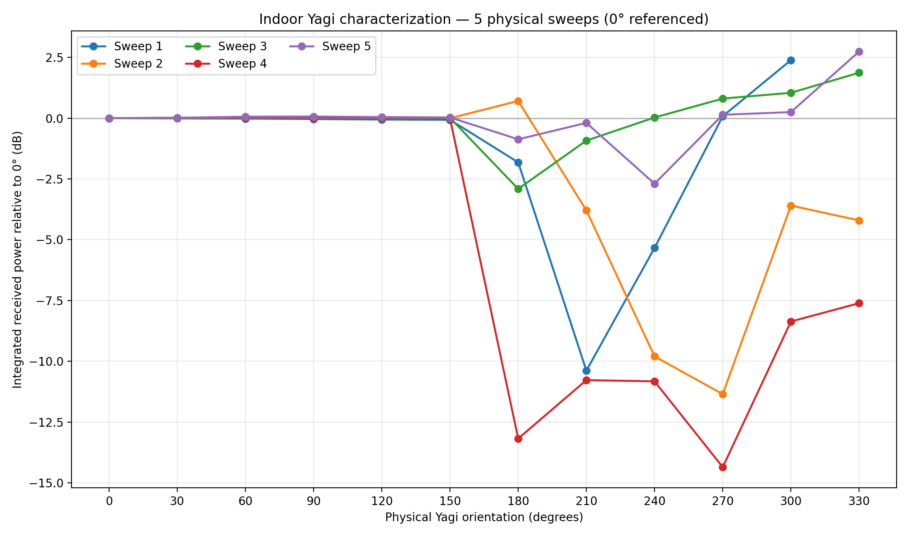
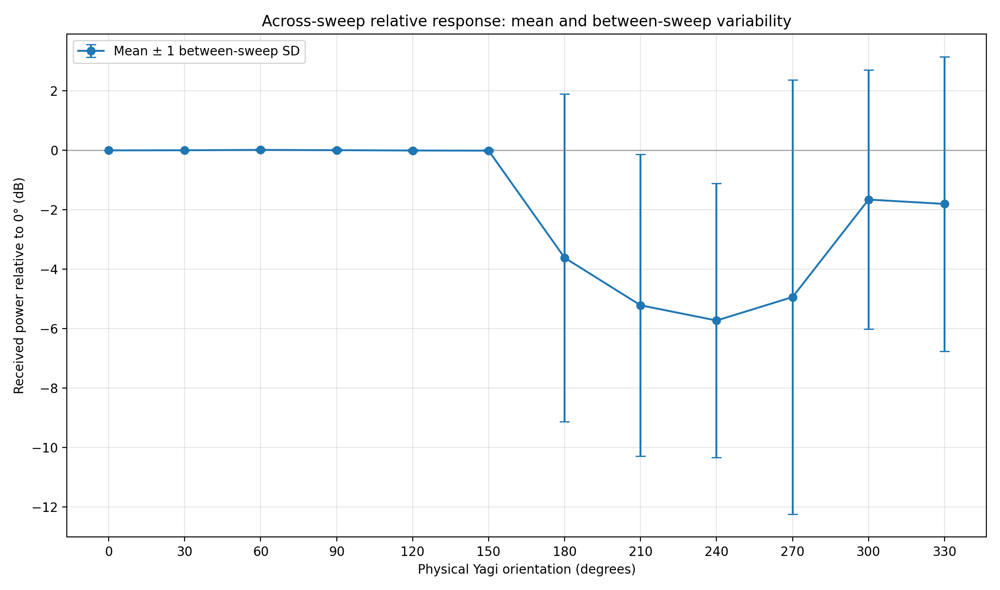

# Yagi characterization — results gallery

**All five measured sweeps and the RF frequency-domain screenshots are linked here.** The recordings are preliminary **indoor, uncalibrated** received sample-power observations—not dBm/dBi or a validated free-space antenna pattern.

## Sweep 1–5: individual plots

The five figures below use the original recorded angle-power data, each referenced to **its own 0° reading**. The original polar screenshots are listed separately. Sweep 1 **does not have a 330° sample**.

### Sweep 1 — 11 measured positions

[Open Sweep 1 plot](plots/sweep_1_relative_power.svg)

### Sweep 2 — 12 measured positions

[Open Sweep 2 plot](plots/sweep_2_relative_power.svg)

### Sweep 3 — 12 measured positions

[Open Sweep 3 plot](plots/sweep_3_relative_power.svg)

### Sweep 4 — 12 measured positions

[Open Sweep 4 plot](plots/sweep_4_relative_power.svg)

### Sweep 5 — 12 measured positions

[Open Sweep 5 plot](plots/sweep_5_relative_power.svg)

## Combined sweep comparisons

[All five sweeps, overlay](plots/yagi_five_sweeps_overlay.png) · [Mean ± standard deviation](plots/yagi_mean_sd_by_angle.png)

## Frequency-domain results — MHz FFT and PSD

The experimental receiver had a **434.2 MHz LO**, with a reference signal observed near **433.921 MHz**. Below are the **original spectrum and PSD screenshots embedded directly** rather than linked only by filename. RF frequency is labeled in **MHz**; plotted magnitudes are uncalibrated, **not dBm or dBm/Hz**.

### Reference transmitter — FFT / PSD captures

**Reference transmitter — frequency-domain capture A**

.png)

**Reference transmitter — frequency-domain capture B**

.png)

### Sweep 4 — recorded frequency-domain captures

**Sweep 4 — frequency-domain capture A**

.png)

**Sweep 4 — frequency-domain capture B**

.png)

### Sweep 5 — recorded frequency-domain captures

**Sweep 5 — frequency-domain capture A**

.png)

**Sweep 5 — frequency-domain capture B**

.png)

**Provenance:** These six files are unchanged screenshots uploaded from the experiments. They do not constitute a complete FFT-and-PSD pair for every sweep; do not infer missing acquisitions from the pictures.

## Original physical-sweep polar screenshots

| Sweep | Original figure |
|---|---|
| 1 | [Polar screenshot](plots/image(20261125-211135).png) |
| 2 | [Polar screenshot](plots/image(20261125-212558).png) |
| 3 | Individual polar screenshot **not present in current uploads**; new graph above comes from recorded CSV |
| 4 | [Polar screenshot](plots/image(20261125-215417).png) |
| 5 | [Polar screenshot](plots/image(20261125-215802).png) |

**Note:** The original polar plots translate the radial minimum to zero, which can exaggerate small relative-power differences. The new Cartesian graphs above present the dB measurements without that distortion.

## Original data and reproducible analysis

- [59 recorded measurements from all five sweeps](data/yagi_five_sweeps_raw.csv)
- [0° normalized sweep data](data/yagi_five_sweeps_relative_to_0deg.csv)
- [Per-angle statistics](data/yagi_angle_statistics.csv)
- [Per-sweep summary](data/yagi_sweep_summary.csv)
- [Consolidated statistical report](../analysis/Yagi_Consolidated_Statistical_Analysis.md)
- [Offline analysis script](../analysis/analyze_yagi.py)

The 0°–150° measurements are unusually flat within individual runs, while results past 180° are inconsistent across runs. Avoid using these preliminary measurements to claim a calibrated Yagi null, front-to-back ratio, or gain.
